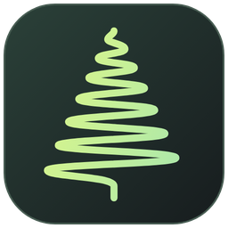
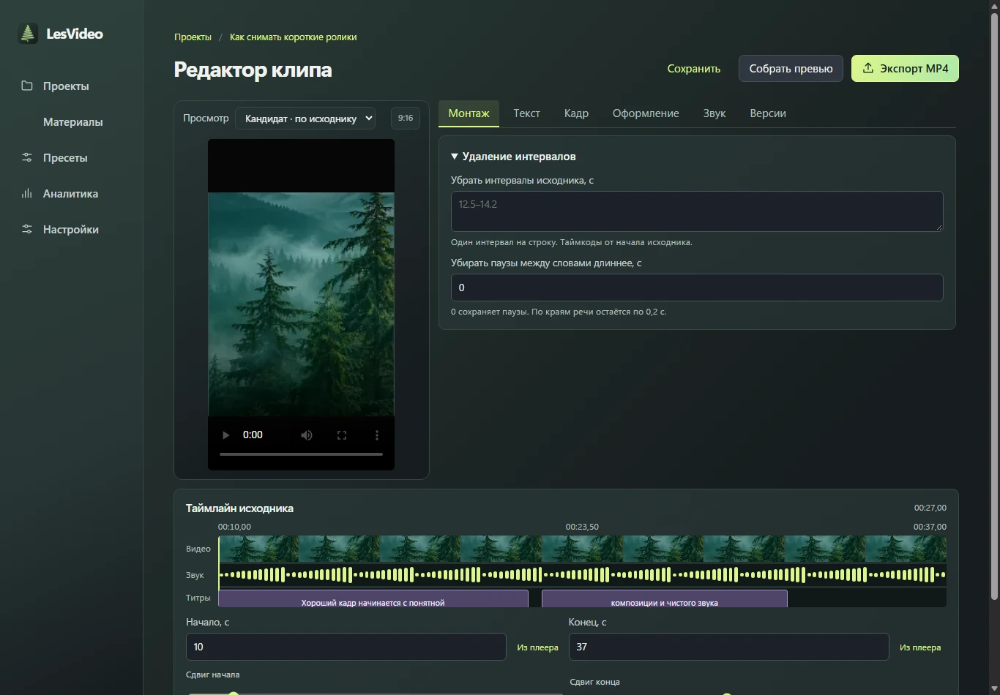
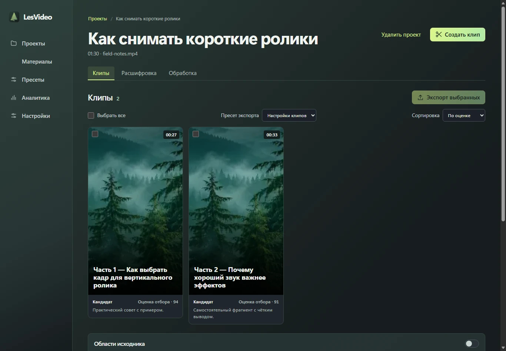

  

<h1 align="center">LesVideo</h1>

<strong>Из длинной записи — в вертикальный клип.</strong>

Локальная видеостудия для стримеров, авторов и монтажёров на Windows.

<a href="https://github.com/ForesterNo1/LesVideo/releases/latest"><strong>Скачать LesVideo</strong></a> · <a href="https://t.me/lesvideo_studio">Telegram</a> · <a href="#возможности">Возможности</a> · <a href="#как-начать">Как начать</a>

## Что делает LesVideo

Есть запись стрима, интервью или вебинара, из которой хочется вырезать несколько сильных моментов? Добавьте видео в проект. LesVideo расшифрует речь, предложит фрагменты с таймкодами и откроет их в редакторе. Вы сможете поправить границы, проверить субтитры и собрать вертикальный MP4 для Shorts, Reels, TikTok или VK Клипов.

## Возможности

- **Локальная расшифровка.** Whisper распознаёт речь и сохраняет таймкоды слов. Чтобы найти нужную реплику, можно перейти к ней прямо из текста. Распознавание и анализ локального файла работают без облачного аккаунта.
- **Поиск моментов в длинном видео.** Qwen3 предлагает клипы по расшифровке и поясняет, чем интересен каждый фрагмент. Например, можно начать с ответа на вопрос из интервью и вручную добавить пару секунд контекста. Клип также можно создать по своему диапазону.
- **Редактор 9:16.** Слева — видео, справа — инструменты, снизу — кадры, звуковая волна и субтитры на одной шкале. Можно настроить кадрирование, поправить текст, убрать лишние интервалы, добавить B-roll, музыку или свой рекламный баннер.
- **Галерея и экспорт.** Сравните кандидатов, выберите удачные и соберите их одним пакетом. Повторный экспорт создаёт отдельную версию MP4. После рендера студия выполняет техническую проверку, а ролик заканчивается короткой анимированной заставкой LesVideo.
- **Источники.** Можно импортировать локальный файл или публичное видео из VK Видео. Для публичных ссылок YouTube доступен импорт, результат которого зависит от подключения и доступности видеопотока. Если ссылка не загружается, можно добавить локальный файл.

## Скачать LesVideo

**Если LesVideo уже установлена**, закройте студию и скачайте пакет из [последнего релиза](https://github.com/ForesterNo1/LesVideo/releases/latest). Запустите его и выберите папку, где уже установлено приложение.

**Для первой установки** скачайте полный офлайн-установщик из [релиза 0.1.0](https://github.com/ForesterNo1/LesVideo/releases/tag/v0.1.0), затем установите пакет обновления.

В одном офлайн-установщике уже есть всё для локальной работы, включая Whisper, Qwen3, FFmpeg и WebView2. Нужна **Windows 11 x64** и свободное место для приложения, моделей и ваших видео. Интернет потребуется для импорта по ссылкам.

## Как начать

1. Скачайте и запустите `LesVideo_Setup_x64.exe`. Выберите папку установки и дождитесь распаковки моделей. Затем установите пакет из последнего релиза.
2. Откройте LesVideo и нажмите **«Новый проект»**. Добавьте запись или вставьте ссылку на поддерживаемое видео.
3. Откройте один из предложенных фрагментов или нажмите **«Создать клип»**. Проверьте границы, кадр и субтитры.
4. Нажмите **«Экспорт MP4»**. Готовый ролик доступен во вкладке **«Версии»**.

## Новости и обратная связь

Новые версии и обсуждение — в [@lesvideo_studio](https://t.me/lesvideo_studio). Канал также открывается по кнопке Telegram в левой панели LesVideo. Если что-то не сработало, приложите версию LesVideo, текст ошибки и шаг, на котором она появилась. Для ошибки импорта полезна публичная ссылка на видео.

[Лицензии сторонних компонентов](LICENSES.md)
